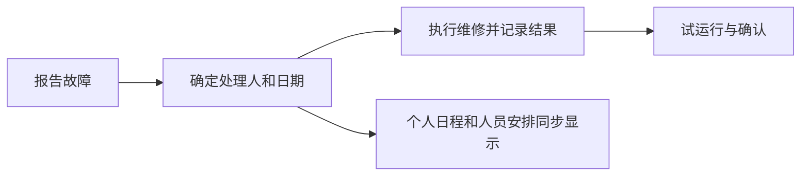

# 成熟产品参考：让 AGV 项目使用起来更连贯

> 本文引用的 QA 回执描述历史时点，原件已[归档](evidence-archive.md)；当前 v3 操作请从[文档入口](index.md)开始。

研究日期：2026-09-16。资料范围为产品官方帮助、官方文档与公开界面示例；未登录试用这些参考产品。下文把已核实的产品机制和面向本系统的设计判断分开。

## 结论先看

建议以 **MaintainX 的现场处理流程、Asana 的模板落地方式、Linear 的统一工作详情**为主要参考，Basecamp 补充协作和记录的处理方式。

目前系统已经实现模板生成项目、维修关联排程、个人日程同步等能力。前几轮更多解决了入口和数据联动；下一步应让用户在同一个工作详情里连续完成操作，减少记住页面位置、重找工作项和重复核对的负担。

本次交付为参考研究与改造建议，未修改应用代码、业务数据或 Docker 部署。以下建议尚未实现，也没有把它们算作已通过测试的功能。

## 当前系统实查：为何仍然感觉乱

在生产实例只读查看项目首页、默认甘特图和项目任务，并对照当前代码。以下为观察及解释，不代表所有角色和项目均已做可用性测试。

| 观察到的情况 | 对使用者的影响 | 建议 |
| --- | --- | --- |
| 项目有五张工作区卡片，下面一层功能按钮，日程内再选甘特图、清单或日历。 | 做事前先要辨认几层入口。 | 保留稳定、写明名称的主入口；任务清单、甘特图、按人安排使用同一套工作详情和筛选上下文。 |
| 390 × 844 手机日程页，目录本身约高 322px；回到页顶后，目录底部在 y=614，日程标题在 y=652，首屏没有实际日程条目。 | 页面没有横向溢出，但需要先滚过大量导航才能看到工作。 | 压缩项目身份栏和导航；首屏应出现当前工作或空态。完整功能目录仍有明确入口，不能把必要动作全部塞入模糊的“更多”。 |
| 人员工作区有“人员安排、我的日程、团队日程”；人员安排内部又有四个标签。 | “我要给某人安排工作”仍要先判断去哪个页面。 | 统一安排界面，以“我 / 团队 / 项目”改变查看范围；成员名册保留为成员管理，不与具体排班混淆。 |
| 任务详情承载检查、参考与交付；人员和时间由其他日程编辑界面处理。 | 同一件事情的要求、安排和结果需要跨页面对照。 | 各处打开同一份工作详情，能直接安排、查看现场记录、提交结果，关闭后回到原列表位置。 |
| 演示项目同时显示总进度 90.9% 和“已完成 0 / 11”。代码中直接完成计入百分比，但不伪造实际填报量。 | 两种口径并列且没有说明，用户容易以为进度错误。 | 明确区分任务完成、实际填报量与项目阶段，给出手动确认完成的说明。不要为了数字一致而改写真实记录。 |

手机证据：[当前日程首屏](evidence-archive.md "原路径：docs/screenshots/reference-study-2026-09-16/current-mobile-schedule.png；SHA256：c509864e63d5b6a2851e83b8c7b7cdb5e26b93f4776ad3b8f192f745230799dc")。代码依据：[项目导航](../frontend/src/pages/pm/project/ProjectMenu.tsx)、[人员安排](../frontend/src/pages/pm/PeoplePlanPage.tsx)、[任务详情](../frontend/src/pages/pm/project/TaskPlanPage.tsx)、[进度计算](../backend/app/services/progress.py)。

## MaintainX：现场工作围绕一张处理单持续推进

### 官方资料中的机制

| 机制 | 可核实的做法 | 来源 |
| --- | --- | --- |
| 工作详情集合执行所需信息 | 工单可关联设备、地点、执行人、开始和截止日期、步骤、图片与文件；新建时可以先提供少量信息，标题是唯一必填字段。 | [Work Order Form Fields](https://help.getmaintainx.com/work-order-form-fields) |
| 多种视图共用工单 | 待办视图左侧列表、右侧详情，选择后可直接查看和编辑；另有表格、日历和负荷视图。 | [View and Filter Work Orders](https://help.getmaintainx.com/view-and-filter-work-orders) |
| 排班能直接行动 | 负荷视图同屏展示各人的工作、日期与可用容量，并支持拖拽分配和排期。该产品此功能有套餐与角色限制。 | [Resource Planning](https://help.getmaintainx.com/about-resource-planning) |
| 结果留在原工作上 | 在工单中执行步骤、更新状态、留评论和照片；执行过程与结果能持续查阅。 | [Complete a Work Order](https://help.getmaintainx.com/complete-a-work-order) |

### 对本系统的启发（设计判断）

从车辆上报告故障，设备、项目和现场信息自动带入；同一个处理详情继续选人、排期、查看备件要求、提交维修记录和试运行结果。已经实现的故障与任务关联可以复用，界面聚合这些关联信息即可，不必把所有业务记录合成一张数据表。

例如，AGV-03 驱动轮损坏：

这条流程中的每一步都留在同一个处理详情内。安排已保存、维修已完成、车辆已恢复分别清楚显示；排了班不能自动代表车辆已修好。一次故障可有多天、多人的工作安排，仍能回看同一故障历史。

### 不适合照搬

完整维护管理系统中的采购、计费和多级工单会增加本系统的理解负担。先借鉴连续处理、明确责任和现场记录。工单的最少必填原则也不意味着省略 AGV 进场准备、安全检查或强制确认理由。保持前端 AI 助手已移除的决定。

## Linear：同一件工作，不因查看角度不同而变成几件事

### 官方资料中的机制

| 机制 | 可核实的做法 | 来源 |
| --- | --- | --- |
| 项目有稳定的上下文 | 项目概览汇集摘要、属性、文档链接、详细说明和里程碑；项目中的 issue 可增加筛选后的共享视图，如“分配给我”“进行中”。 | [Projects](https://linear.app/docs/projects) |
| 视图复用已有工作 | 列表和看板可以改变分组、排序、显示字段；个人显示偏好与团队默认设置可以分别保存。 | [Display options](https://linear.app/docs/display-options) |
| 分派后自然进入个人工作 | issue 指派给一个负责人后，会自动进入其 My Issues；指派变更也自动更新该视图，历史留在工作项活动中。 | [Assign and delegate issues](https://linear.app/docs/assigning-issues) |
| 个人页面有优先顺序 | My Issues 按紧急、阻塞、周期内工作等类别聚焦；只在适用时显示对应分组，组内按优先级组织，并优先显示已开始的工作。 | [My issues](https://linear.app/docs/my-issues) |
| 模板直接生成项目内容 | 项目模板可预设负责人、成员、状态、里程碑和 issues；使用模板时直接创建带这些内容的新项目。 | [Project templates](https://linear.app/docs/project-templates) |

### 对本系统的启发（设计判断）

- 统一“工作详情”：从项目任务、甘特条、个人日程或维修记录进入，都能看到同一工作的负责人、安排、检查步骤、结果与附件，并在当处继续操作。
- 项目内的“计划”“按人看”“本周待办”成为同一份工作的查看方式，切换时保留项目、时间范围和当前工作。已有的维修联动、个人日程应接入这个共同入口。
- 日常首页先回答“我现在做什么、什么被卡住、什么等我确认”；统计放在后面，减少用户自行判断下一步的负担。

### 不适合照搬

Linear 的 issue、cycle 等软件团队语言不适合原样放到现场实施页面。其快捷键、右键菜单和自定义筛选也不能代替本系统的可见操作；用户已经明确表示容易找不到功能。保留“安排人员”“报告问题”“提交结果”等直接动作。

## Asana：模板带出可执行计划，个人工作自动承接项目分派

### 官方资料中的机制

| 机制 | 可核实的做法 | 来源 |
| --- | --- | --- |
| 同一项目提供不同视图 | 项目有列表、看板、甘特、时间线和日历等视图；项目概览用于说明做什么、为何做、如何协作。可保存筛选与排序为新的视图标签。 | [Project customization and views](https://help.asana.com/s/article/project-customization-and-views) |
| 模板表达相对安排 | 模板日期可以相对项目开始或截止日期设置；角色占位可在新建项目时绑定具体成员，并自动分配相应任务。角色功能有套餐限制。 | [Project templates](https://help.asana.com/s/article/project-templates?language=en_US) |
| 个人待办来自实际指派 | My Tasks 汇集跨项目分派给自己的任务；新指派的任务自动进入 Recently Assigned，可按日期、项目、优先级等组织。 | [Maximize productivity with My tasks](https://help.asana.com/s/article/maximize-productivity-with-my-tasks) |
| 待办与消息职责清楚 | My Tasks 用来推进自己的工作；Inbox 汇集任务、消息、状态更新和项目活动通知。 | [Quick-start guide](https://help.asana.com/s/article/quick-start-guide-to-asana) |

### 对本系统的启发（设计判断）

- 模板预览应回答“选完会得到哪些阶段、哪几项工作、要什么人、缺哪些条件”，并使用与实际项目计划一致的结构。项目创建完成后沿着这份计划继续补齐准备、确认人员、排期。
- 模板中的“实施工程师”“电气支持”等岗位先保留为待分配角色，随后集中绑定具体人；允许创建后补齐和更换。不要让用户逐项重复选人，也不要自动把未确认人员当成已承诺安排。
- 已有个人日程继续使用真实分派数据。工作项只分派一次，个人日程、人员安排和项目计划同步显示；消息负责提醒，不再成为另一套待办清单。

### 不适合照搬

Asana 支持很多视图和大量可保存标签，这是扩展能力，不应成为本系统的默认页面数量。这里需要少量有明确用途的预设视图。官方模板文档还提示：跳过角色绑定会留下未分配任务；本系统更适合把缺口留为可补齐的明确事项，避免创建向导成为唯一机会。以上为针对本系统的取舍，不代表 Asana 功能缺失。

## Basecamp：让项目成为完整工作场所，讨论跟着具体事情走

### 官方资料中的机制

| 机制 | 可核实的做法 | 来源 |
| --- | --- | --- |
| 项目承载协作上下文 | 项目内可启用待办、讨论、日程、资料、Card Tables 等工具；围绕某个待办的讨论保留在该待办上。 | [The Basecamp Way To Work](https://5.basecamp-help.com/article/1072-the-basecamp-way-to-work) |
| 卡片承接有阶段的工作 | Card Table 卡片可包含负责人、截止日、细节、评论及子任务；已分配卡片进入个人安排，有日期的卡片进入日历。列代表工作阶段。 | [Card Tables](https://5.basecamp-help.com/article/1063-card-tables) |
| 个人页跨项目汇总 | My Assignments 聚合各项目的待办和卡片，并区分自己的工作、有日期的工作、分派给他人的工作；Up Next 可把当前最重要的事项置顶。 | [My Assignments](https://5.basecamp-help.com/article/1178-my-assignments) |
| 模板既能复用，也保持实例独立 | 项目可另存为模板，日期相对项目开始日调整；已完成待办恢复为未完成，卡片回到待处理。后续修改模板不会改动已生成项目。 | [Templates](https://5.basecamp-help.com/article/1094-project-and-list-templates) |

### 对本系统的启发（设计判断）

- 一个维修处理卡里看清“谁来修、什么时候、缺什么、怎么判断修好、现场结果、谁确认”，讨论和照片就留在卡里。用户不必往返车辆、问题、日程和资料页面拼出完整故事。
- 用稳定的项目位置承载团队共同上下文；个人页提供跨项目入口，打开后仍回到同一工作详情。人员换班或经理移交时，接手者能直接读懂历史和未完事项。
- 模板保存可复用的方法和步骤；当前项目保存本次客户、人员、时间和现场结果。模板更新如何应用到进行中项目，应以明确预览和差异处理完成，不能悄悄覆盖。

### 不适合照搬

Basecamp 的 To-dos 与 Card Tables 是不同工具，不能据此声称它们所有页面都是同一任务的不同视图。本系统也不宜复制整排聊天、留言、日历和看板工具入口；应借鉴“上下文留在事情旁边”，避免再次把项目做成工具目录。

## 参考资料阅读顺序

1. 先看 [MaintainX 的列表与工作详情示例](https://help.getmaintainx.com/view-and-filter-work-orders#to-do-view)：最接近现场维修的连续操作。
2. 看 [Asana 的模板角色与相对日期](https://help.asana.com/s/article/project-templates?language=en_US)：理解模板怎样变成可执行项目。
3. 看 [Linear 的项目与视图](https://linear.app/docs/projects)：理解项目上下文与不同视图如何共用已有工作。
4. 补充 [Basecamp 的卡片示例](https://5.basecamp-help.com/article/1063-card-tables)：理解安排、讨论和结果如何留在同一件事上。

说明：Asana 帮助正文可通过官方域名搜索索引读取；直接打开部分页面时返回其 CSS 加载错误。本研究采用索引中实际可读取的官方正文，未据此声称已验证登录后的操作。

## 建议的落地顺序

### 第一轮：把一件工作办顺

- 先统一工作详情，让项目任务、甘特条、人员安排、个人日程和车辆维修打开相同的内容；保留各自查看角度。
- 详情首段固定回答“做什么、谁负责、什么时候、当前缺什么”；下面接执行步骤、现场结果和附件。相关按钮写具体动作。
- 桌面保留列表上下文，在旁边处理详情；手机进入完整详情，返回时保留筛选、日期和滚动位置。
- 延续日程默认甘特图的偏好；加入工作时只录入一次，改人改期沿用原关联，不另建一份个人待办。

### 第二轮：让创建项目自然接上实施

- 普通使用者选择“实施方案”，预览创建后的阶段、工作、进场条件和交付要求；预览结构与实际项目一致。
- 车辆数量、时间基准和人员角色放入同一份计划上下文，显示已经带入的值和需要补齐的地方。
- 创建后直接继续这份计划，能保存未完成的准备；下达前清楚列出缺人、缺日期和未落实条件。
- 模板后续更新仍不能覆盖项目现场修改；补充工作沿用明确预览。现有准备确认、强制理由及审计保留。

### 第三轮：统一页面和视觉主次

- 项目首页聚焦当前阶段、接下来要做的事、待确认和受阻事项；每条都写明责任人和动作，避免重复展示整套入口和开工卡片。
- 缩小大色块导航和反复出现的标题，使用浅灰绿背景、清楚的内容分区和少量状态色；项目、任务、人员详情的按钮位置保持一致。
- “需要我审批”进入个人待处理入口；经理移交在项目上下文发起，能同时看到未完工作和接收人。移交、删除记录保留直接可见的访问入口。
- 必要功能仍可从写明名称的目录进入；先做上下文内的直达操作，再减少重复页面。不要先隐藏入口再让用户自行寻找。

## 如何判断这轮是否真的更好用

用以下三个场景验收，记录操作路径、页面切换和重复填写情况。以下是目标，并非本次已完成的测试结果。

1. **新项目**：选择方案和车辆，绑定实施人员，得到计划预览；能明确说出还缺哪些条件、下一步在哪操作，不用回模板编辑器完成当前项目。
2. **现场坏车**：从故障记录安排维修，在个人日程打开同一处理详情，填写结果和试运行记录，再确认恢复；项目、人员与个人视图中均只有关联的同一份工作。
3. **人员临时变动**：在人员安排看到请假与冲突，直接改人改期；原工作说明和附件不丢失，相关人收到变更提醒，项目视图同步反映结果。

同时检查：390px 手机首屏是否有实际工作或明确空态；返回后是否保留原位置；无权限、加载失败、暂未填写和没有记录是否分别说明。统一详情按需要读取数据，验证请求次数与等待时间，避免把所有模块一次性塞进一个慢页面。不能仅以菜单数减少或自动测试通过，替代真实办事过程的验证。
